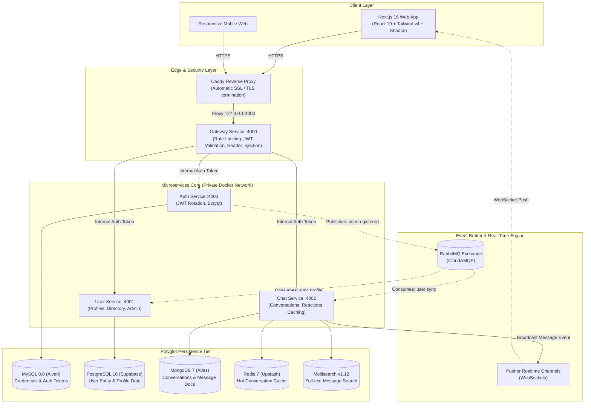
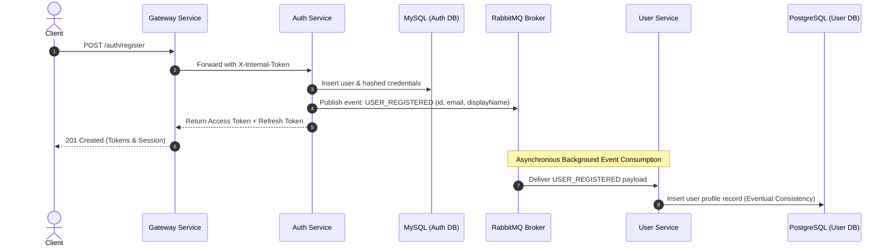
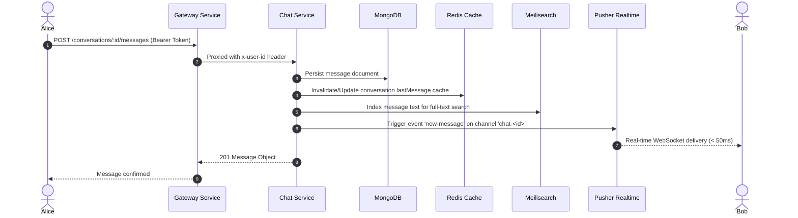

<p align="center">
  
  
  
  
  
  
  
  
</p>

<h1 align="center">🚀 Production-Ready Distributed Real-Time Chat Platform</h1>

<p align="center">
  <strong>An enterprise-grade, event-driven microservices chat application built with TypeScript, Next.js 16, Node.js 22, and Polyglot Persistence.</strong>
</p>

<p align="center">
  
  
  
  
  
  
  
</p>

---

## 📑 Table of Contents

- [Executive Summary](#-executive-summary)
- [System Architecture](#-system-architecture)
- [Key Engineering Highlights (Interview Focus)](#-key-engineering-highlights-interview-focus)
- [Technology Matrix](#-technology-matrix)
- [Microservices Deep Dive](#-microservices-deep-dive)
- [Real-Time & Event-Driven Flows](#-real-time--event-driven-flows)
- [Monorepo Structure](#-monorepo-structure)
- [Environment Configuration](#-environment-configuration)
- [Local Development Setup](#-local-development-setup)
- [Production Deployment (GCP VM + Dokploy + Caddy)](#-production-deployment-gcp-vm--dokploy--caddy)
- [API Reference](#-api-reference)
- [License](#-license)

---

## 📌 Executive Summary

This project showcases a scalable, highly available distributed chat system engineered around **Microservices Architecture**, **Polyglot Persistence**, and **Event-Driven Asynchronous Messaging**. 

Designed to mimic high-scale consumer messaging backends (like Slack or Discord), it addresses real-world distributed challenges:
- **Zero-trust internal service mesh** with API Gateway token authorization.
- **Data consistency** across independent databases via **RabbitMQ** event sourcing.
- **Polyglot database selection**: Right database for the right workload (MySQL for ACID auth, PostgreSQL for relational user profiles, MongoDB for high-throughput messaging, Redis for sub-millisecond caching, and Meilisearch for typo-tolerant full-text search).
- **Sub-millisecond real-time push** using Pusher Channels / WebSockets.
- **Modern Next.js 16 fullstack client** featuring NextAuth v5, TanStack Table for administration, dynamic theme switching, and Cloudinary media processing.

---

## 🏗️ System Architecture



---

## 💡 Key Engineering Highlights (Interview Focus)

### 1. Database-Per-Service & Polyglot Persistence
Instead of a single monolithic database bottleneck, each service owns its datastore according to read/write characteristics:
- **MySQL 8.0 (Auth Service)**: Strict ACID compliance, foreign-key guarantees, and atomic operations for credential validation and refresh token lifecycle.
- **PostgreSQL 16 (User Service)**: Relational profile queries, complex indexing, admin pagination, and rich schema migrations.
- **MongoDB 7 (Chat Service)**: High-write document database ideal for unstructured/polymorphic message payloads, thread trees, and unread counts.
- **Redis 7 (Upstash)**: Read-through caching for active conversations, participant sets, and rapid lookup to eliminate repetitive MongoDB disk I/O.
- **Meilisearch v1.12**: Dedicated search index for ultra-fast, typo-tolerant full-text search across thousands of chat messages.

### 2. Event-Driven Architecture with RabbitMQ
- **Loose Coupling**: Services don't invoke each other synchronously for secondary side effects. When a user registers in `auth-service`, it publishes a `user.created` event to RabbitMQ.
- **Eventual Consistency**: `user-service` asynchronously consumes the message and provisions the user profile. If `user-service` is temporarily down, messages persist in durable queues and replay automatically upon recovery.

### 3. Defense-in-Depth API Gateway Pattern
- **Centralized Ingress**: The Gateway acts as the single public entrypoint, applying security headers (`Helmet`), CORS policies, and IP rate limiting (`express-rate-limit`).
- **Internal API Signing**: Services sit inside a private Docker bridge network. Every proxied request carries an authenticated `X-Internal-Token`. Direct external requests to internal services are rejected with `403 Forbidden`.
- **JWT Context Propagation**: Gateway decodes access tokens and injects verified user identity headers (`x-user-id`, `x-user-email`) into downstream requests, freeing individual microservices from redundant token decoding.

### 4. Cloud DB Hibernation Prevention (`/keep-alive`)
- Free-tier serverless cloud databases (Supabase, Aiven, Mongo Atlas, Upstash) hibernate after periods of inactivity.
- An orchestrated `/keep-alive` endpoint is periodically invoked by Upstash QStash / cron, pinging all downstream DB connections concurrently via `Promise.allSettled()` to guarantee near-zero cold-start latency.

### 5. Type-Safe Monorepo Architecture
- Powered by **pnpm workspaces**, ensuring strict dependency isolation with lightning-fast linking.
- Shared `@chatapp/common` internal package eliminates boilerplate by distributing:
  - Zod validation schemas across Gateway and microservices.
  - Custom `HttpError` inheritance hierarchy with uniform JSON responses.
  - Type-safe RabbitMQ event interfaces.
  - High-performance structured logging (`pino`).

---

## 💻 Technology Matrix

### Frontend (Client-Side)

| Category | Library / Technology | Purpose |
| :--- | :--- | :--- |
| **Framework** | Next.js 16 (App Router) | Server-Side Rendering (SSR), Server Actions, Route Handlers |
| **Core** | React 19 + TypeScript 5 | Concurrent UI rendering, strict type checking |
| **Styling** | Tailwind CSS v4 + PostCSS | Zero-runtime CSS engine, modern design tokens |
| **UI Components** | Shadcn UI + Radix / Base UI | Accessible, headless UI primitives |
| **Authentication** | NextAuth v5 (Auth.js Beta) | Google OAuth 2.0 & Credentials provider with JWT sessions |
| **Real-Time Client**| Pusher-js (v8.6) | WebSocket channel subscription for messages & typing status |
| **Data Grid** | TanStack React Table (v8) | Headless data table for Admin User Management |
| **Media Management**| Cloudinary SDK | Cloud image upload, compression, and delivery |
| **UX Addons** | Sonner | Modern animated toast notification system |
| **Theme** | next-themes | Instant Dark / Light mode switching |
| **Icons & Extras** | Lucide React + Emoji Picker React | Modern icon set & integrated emoji reaction picker |

### Backend & Infrastructure (Server-Side)

| Category | Technology | Implementation Details |
| :--- | :--- | :--- |
| **Runtime** | Node.js 22 LTS | ESM native module resolution, high performance |
| **Web Framework**| Express 5 | Next-gen Express with native async error handling |
| **Language** | TypeScript 5 | Strict mode compilation across all workspaces |
| **Message Broker**| RabbitMQ 3 (`amqplib`) | Hosted on CloudAMQP; durable queues & topic exchanges |
| **In-Memory Cache**| Redis 7 (`ioredis`) | Hosted on Upstash Redis; low-latency key-value cache |
| **Full-Text Search**| Meilisearch v1.12 | Self-hosted container; typo-tolerant message indexing |
| **Databases** | MySQL 8.0, PostgreSQL 16, MongoDB 7 | Hosted on Aiven, Supabase, and MongoDB Atlas |
| **ORM / Drivers** | Sequelize 6 (`pg`, `mysql2`), MongoDB Native Driver | Type-safe migrations and high-throughput document streaming |
| **Validation** | Zod (v3) | Runtime schema validation for requests and environments |
| **Logging** | Pino & Pino-Pretty | Low-overhead JSON structured logging |
| **Reverse Proxy** | Caddy 2 | Automatic Let's Encrypt SSL, HTTP/2 & HTTP/3 termination |
| **Orchestration**| Docker & Docker Compose / Dokploy | Production multi-stage containers with CPU/memory limits |

---

## 📦 Microservices Deep Dive

```
chat-app-microservices/
├── apps/
│   └── frontend/              # Next.js 16 Web Application
├── packages/
│   └── common/                # Shared utilities, schemas, errors, & event contracts
└── services/
    ├── gateway-service/       # API Gateway (Port 4000)
    ├── auth-service/          # Authentication & Token Manager (Port 4003)
    ├── user-service/          # Profile & User Directory (Port 4001)
    └── chat-service/          # Messaging, Reactions & Full-Text Search (Port 4002)
```

### 1. Gateway Service (`:4000`)
- **Role**: Reverse proxy router, security gatekeeper.
- **Responsibilities**:
  - Validates client JWT access tokens on incoming HTTP requests.
  - Injects `x-user-id` and `X-Internal-Token` headers before proxying to downstream services.
  - Applies IP rate limiting on sensitive routes (`/auth/login`, `/auth/register`).
  - Implements the distributed database `/keep-alive` orchestration endpoint.

### 2. Auth Service (`:4003`)
- **Role**: Authentication authority and credential store.
- **Database**: MySQL 8.0 (via Sequelize).
- **Responsibilities**:
  - Secure credential registration with `bcrypt` password hashing.
  - Issues short-lived Access Tokens (JWT) and persistent Refresh Tokens.
  - Token rotation mechanism to mitigate replay attacks.
  - Publishes `user.created` event payload to RabbitMQ upon user registration.

### 3. User Service (`:4001`)
- **Role**: User entity, profile attributes, and administrative actions.
- **Database**: PostgreSQL 16 (via Sequelize).
- **Responsibilities**:
  - Consumes RabbitMQ registration events to initialize profile records asynchronously.
  - Profile retrieval, bio/avatar updates, and user directory search.
  - Admin management endpoints for user roles and status.

### 4. Chat Service (`:4002`)
- **Role**: High-speed messaging, chat rooms, reactions, and search.
- **Database**: MongoDB 7 + Redis 7 + Meilisearch v1.12.
- **Responsibilities**:
  - Manages 1-on-1 and Group conversations.
  - Stores messages with cursor-based pagination for smooth infinite scrolling.
  - Caches active conversation records in Redis for instant retrieval.
  - Emits real-time message payloads via Pusher Channels.
  - Indexes message content into Meilisearch for instant search.
  - Message reactions (emojis) and read receipts with unread badge counters.

---

## 🔄 Real-Time & Event-Driven Flows

### User Registration & Asynchronous Synchronization



### Real-Time Messaging & Search Indexing



---

## ⚙️ Environment Configuration

Copy the example environment file:

```bash
cp .env.example .env
```

Key environment configurations:

```env
# General
NODE_ENV=production

# Cloud SaaS Database URLs
AUTH_DB_URL=mysql://<user>:<password>@<aiven-host>:<port>/<dbname>?ssl-mode=REQUIRED
USER_DB_URL=postgresql://<user>:<password>@<supabase-host>:5432/postgres
MONGO_URL=mongodb+srv://<user>:<password>@<cluster>.mongodb.net/chatapp_chat_service?retryWrites=true&w=majority
REDIS_URL=rediss://default:<password>@<upstash-endpoint>:6379
RABBITMQ_URL=amqps://<user>:<password>@<cloudamqp-host>/<vhost>

# Full-Text Search
MEILISEARCH_HOST=http://127.0.0.1:7700
MEILISEARCH_MASTER_KEY=your_secure_master_key

# Real-Time Pusher
PUSHER_APP_ID=your_pusher_app_id
PUSHER_KEY=your_pusher_key
PUSHER_SECRET=your_pusher_secret
PUSHER_CLUSTER=ap1

# Internal & JWT Security (Generate with openssl rand -base64 48)
JWT_SECRET=super_secret_jwt_access_key
JWT_REFRESH_SECRET=super_secret_jwt_refresh_key
INTERNAL_API_TOKEN=super_secret_internal_service_mesh_key
JWT_EXPIRES_IN=1d
JWT_REFRESH_EXPIRES_IN=30d

# Microservice Ports (Host Mapping)
GATEWAY_PORT=4000
AUTH_SERVICE_PORT=4003
USER_SERVICE_PORT=4001
CHAT_SERVICE_PORT=4002

# Cloudinary & Google OAuth (Frontend)
CLOUDINARY_CLOUD_NAME=your_cloudinary_name
CLOUDINARY_API_KEY=your_cloudinary_key
CLOUDINARY_API_SECRET=your_cloudinary_secret
AUTH_GOOGLE_ID=your_google_oauth_client_id
AUTH_GOOGLE_SECRET=your_google_oauth_client_secret
```

---

## 🛠️ Local Development Setup

### Prerequisites
- **Node.js**: `v22.x` or higher
- **pnpm**: `v10.x` or higher
- **Docker**: For local containers / Meilisearch

### 1. Install Workspace Dependencies

```bash
pnpm install
```

### 2. Build the Shared Package

```bash
pnpm --filter @chatapp/common build
```

### 3. Run the Entire Stack Concurrently

Because all databases and brokers utilize Cloud SaaS tiers (Supabase, Aiven, Mongo Atlas, Upstash, CloudAMQP), you can spin up the full stack locally without running heavy database containers:

```bash
# Starts Gateway, Auth, User, Chat microservices and Next.js frontend concurrently:
pnpm dev
```

Alternatively, start services individually:

```bash
# Backend services only:
pnpm --filter gateway-service dev
pnpm --filter @chatapp/auth-service dev
pnpm --filter @chatapp/user-service dev
pnpm --filter chat-service dev

# Frontend only:
pnpm --filter frontend dev
```

### 4. Optional: Run Local Databases via Docker Compose
If you prefer running databases locally instead of cloud providers, use the `local-db` profile:

```bash
docker compose --profile local-db up -d
```

---

## 🚀 Production Deployment (GCP VM + Dokploy + Caddy)

The production deployment is optimized for low memory footprints, high reliability, and zero-downtime container management.

### Deployment Topography

```
[ Internet ] 
     │
     ▼ (Port 80/443 with Auto-SSL)
[ Caddy Web Server on GCP VM ]
     │
     ▼ (Proxy Pass to 127.0.0.1:4000)
[ Gateway Service Container ]
     │
     ├── (Docker Bridge Network) ──► [ Auth Service Container ] ──► [ Aiven MySQL ]
     ├── (Docker Bridge Network) ──► [ User Service Container ] ──► [ Supabase Postgres ]
     └── (Docker Bridge Network) ──► [ Chat Service Container ] ──► [ Mongo Atlas + Upstash Redis ]
                                            │
                                            └──► [ Local Meilisearch Container ]
```

### 1. Deploying via Dokploy / Docker Compose

The `docker-compose.prod.yml` configuration is engineered for production workloads:
- Sets strict memory ceilings (`mem_limit: 192m-256m`) to prevent VM Out-Of-Memory (OOM) crashes.
- Configures JSON log rotation (`max-size: 10m`, `max-file: 3`).
- Binds Gateway strictly to `127.0.0.1:4000`, keeping all internal services isolated from public access.

Deploy on your server:

```bash
docker compose -f docker-compose.prod.yml up -d --build
```

### 2. Caddy Reverse Proxy Configuration (`Caddyfile`)

Caddy handles automatic SSL/TLS certificate generation via Let's Encrypt:

```caddy
api.yourdomain.com {
    reverse_proxy 127.0.0.1:4000 {
        header_up Host {host}
        header_up X-Real-IP {remote}
        header_up X-Forwarded-For {remote}
        header_up X-Forwarded-Proto {scheme}
    }
}
```

Reload Caddy:
```bash
sudo systemctl reload caddy
```

### 3. Frontend Deployment (Vercel)
The `apps/frontend` Next.js application deploys seamlessly on **Vercel**:
- Set root directory to `apps/frontend`.
- Add environment variables: `NEXTAUTH_SECRET`, `GATE_WAY_URL` (pointing to `https://api.yourdomain.com`), `PUSHER_*`, `CLOUDINARY_*`, `AUTH_GOOGLE_*`.

---

## 📖 API Reference

All requests route through the Gateway at `http://localhost:4000` (or `https://api.yourdomain.com`).

### Authentication (`/auth`)

| Method | Endpoint | Description | Auth Required |
| :--- | :--- | :--- | :--- |
| `POST` | `/auth/register` | Register user credentials & publish sync event | No |
| `POST` | `/auth/login` | Authenticate with email/password; returns JWTs | No |
| `POST` | `/auth/refresh` | Rotate access token using valid refresh token | No |
| `POST` | `/auth/revoke` | Invalidate active refresh tokens for user | Yes |

### User Directory (`/users`)

| Method | Endpoint | Description | Auth Required |
| :--- | :--- | :--- | :--- |
| `GET` | `/users` | List user profiles with pagination | Yes |
| `GET` | `/users/search?q=:name` | Search users by name or email | Yes |
| `GET` | `/users/:id` | Fetch specific user profile details | Yes |
| `PUT` | `/users/:id` | Update profile information | Yes |
| `DELETE`| `/users/:id` | Delete user profile (Admin) | Yes (Admin) |

### Conversations & Messages (`/conversations`)

| Method | Endpoint | Description | Auth Required |
| :--- | :--- | :--- | :--- |
| `POST` | `/conversations` | Create a 1-on-1 or Group conversation | Yes |
| `GET` | `/conversations` | List user's active conversations | Yes |
| `GET` | `/conversations/:id` | Get details and participants of a conversation | Yes |
| `GET` | `/conversations/unread-count` | Get total unread messages count | Yes |
| `POST` | `/conversations/:id/messages` | Send message (broadcasts via Pusher) | Yes |
| `GET` | `/conversations/:id/messages` | List paginated messages with cursor navigation | Yes |
| `GET` | `/conversations/:id/messages/search?q=:term` | Full-text message search (Meilisearch) | Yes |
| `POST` | `/conversations/:id/messages/:msgId/reactions` | Add emoji reaction to message | Yes |
| `PATCH`| `/conversations/:id/read` | Mark conversation messages as read | Yes |

### System & Health

| Method | Endpoint | Description |
| :--- | :--- | :--- |
| `GET` | `/health` | Service health check |
| `ALL` | `/keep-alive` | Pings all cloud databases to prevent sleep/hibernation |

---

## 📄 License

This project is licensed under the [ISC License](LICENSE).
